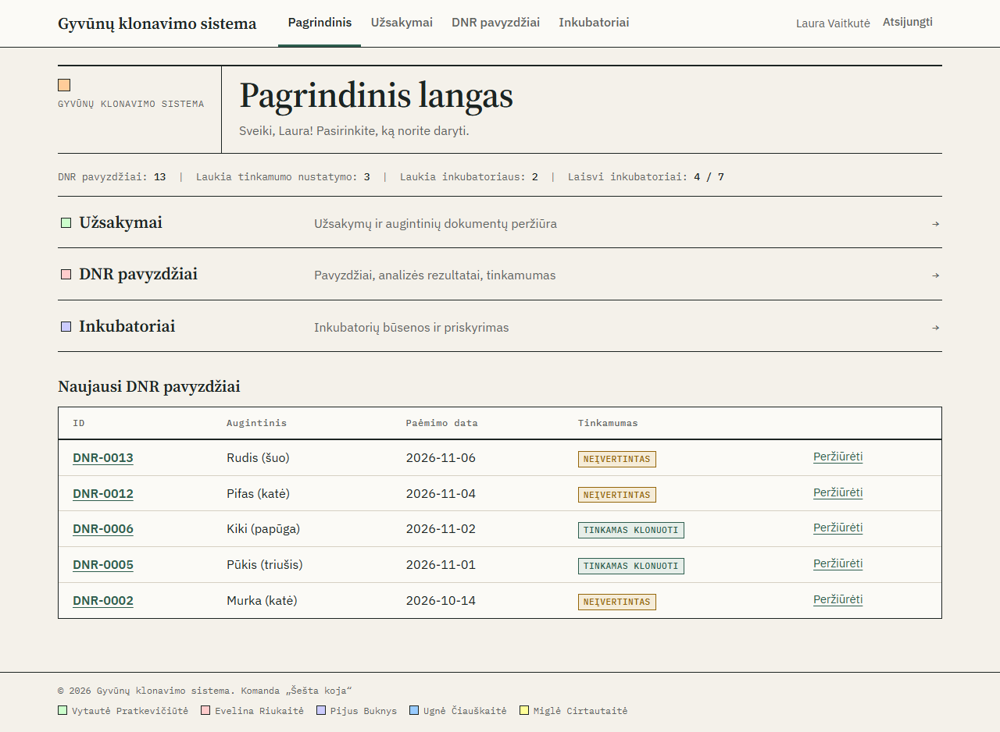

# Gyvūnų klonavimo sistema

[](https://github.com/cmigle/gyvunu_klonavimo_sistema/actions/workflows/ci.yml)

An information system for a pet cloning laboratory: clients register their pets and order cloning, lab specialists analyse DNA samples and run incubators, administrators manage staff and their workload. A team project for the *Information Systems Fundamentals* course (P170B114) at Kaunas University of Technology that goes from UML requirements and analysis models through a clickable prototype to a working ASP.NET Core MVC application.

The user interface and the domain model are in Lithuanian, as the course required; class, controller and table names follow the UML vocabulary one-to-one.



## What it does

| Subsystem | Highlights |
|---|---|
| Clients and pets | Registration and login for clients and staff, pet profiles, document upload (PDF/JPG/PNG), criminal record check through the CourtListener API |
| Orders | Price by animal type, an order per pet, edits only while unconfirmed; **confirmed automatically** once the pet's DNA sample passes analysis, with an email to the client |
| DNA samples | Sample registration with printable labels, lab results entry, automatic suitability check against six biological thresholds with a certificate or rejection report |
| Incubators | Equipment parameters and measurements, automatic assignment of the closest-matching free incubator to an embryo |
| Employees | Staff management, each specialist's cloning history, workload analysis (low / normal / high) |

## How it is built

- **ASP.NET Core MVC on .NET 10** – the analysis model's «boundary» windows are Razor views, «control» classes are controllers, «entity» classes are EF Core models ([architecture](docs/architektura.md))
- **MySQL 8.4, schema first** – the app creates its database from [`database/schema.sql`](database/schema.sql), the same script documented in [the database schema](docs/duomenu-baze.md): 11 tables with foreign keys, unique and `CHECK` constraints
- **Automatic functions as pure code** – DNA suitability, incubator assignment and workload analysis have no database dependency and are covered by xUnit tests
- **External systems behind interfaces** – CourtListener (demo data without an API token) and SMTP (emails saved as `.eml` without a server)
- **CI** – GitHub Actions builds, runs the tests and starts the app against a MySQL container on every pull request
- **Git workflow** – every subsystem was developed on its own branch and merged through a pull request

## Running locally

Requirements: [.NET 10 SDK](https://dotnet.microsoft.com/download/dotnet/10.0) and MySQL 8.4 listening on `127.0.0.1:3306` as `root` without a password (change `ConnectionStrings:KlonavimoDb` in `src/GyvunuKlonavimoSistema/appsettings.json` otherwise). On Windows, `scripts/paleisti-mysql.ps1` starts an installed MySQL 8.4 server without setting up a service.

```bash
dotnet run --project src/GyvunuKlonavimoSistema
# http://localhost:5181 – the database is created and filled with demo data on first start
dotnet run --project src/GyvunuKlonavimoSistema -- --atkurti-duomenis   # recreate the demo database
dotnet test
```

Demo accounts (password `demo1234`):

| Account | Role | Try |
|---|---|---|
| jonas@pavyzdys.lt | Client | create an order for Žaibas |
| ruta@pavyzdys.lt | Client | history not checked yet – "Petras Petraitis" has court records |
| laura@klonavimas.lt | Lab specialist | determine DNR-0002 suitability → order UZ-0002 is confirmed and an email is written to `laiskai/`; assign an incubator to Kiki (succeeds) and Pūkis (none suitable) |
| asta@klonavimas.lt | Administrator | employees, their research, workload analysis |

## Repository

| Path | Contents |
|---|---|
| [`src/`](src/GyvunuKlonavimoSistema) | ASP.NET Core MVC application |
| [`tests/`](tests/GyvunuKlonavimoSistema.Tests) | Unit tests |
| [`database/`](database) | MySQL schema |
| [`docs/`](docs) | UML models, architecture, database schema, conclusions (Lithuanian) |
| [`prototype/`](prototype) | Clickable HTML/CSS/JS prototype made before the implementation |

## Team „Šešta koja“

Subsystem responsibilities as planned in the project report; the colour of each subsystem in the UI and diagrams follows this split.

| Member | Subsystem |
|---|---|
| Miglė Cirtautaitė | Clients and pets |
| Vytautė Pratkevičiūtė | Orders |
| Evelina Riukaitė | DNA samples |
| Pijus Buknys | Incubators |
| Ugnė Čiauškaitė | Employees |
