# Reikalavimų analizės modelis

## 3.1. Panaudojimo atvejų analizės diagramos

Kiekvienas panaudojimo atvejis išskaidytas į «boundary» (naudotojo sąsajos langai, išorinės sąsajos), «control» (valdikliai) ir «entity» (esybės) klases. Šios klasės tiesiogiai atitinka realizuotos sistemos [MVC architektūrą](architektura.md): langai – rodiniai (*views*), valdikliai – kontroleriai, esybės – modelio klasės.

| Valdiklis | Panaudojimo atvejai |
|---|---|
| Prisijungimo valdiklis | Prisijungti |
| Kliento valdiklis | Registruotis, Atsijungti |
| Istorijos patikrinimo valdiklis | Patikrinti kliento istoriją (per «boundary» CourtListener API sąsają) |
| Augintinio valdiklis | Sukurti, peržiūrėti, redaguoti, ištrinti gyvūną |
| Dokumentų valdiklis | Peržiūrėti dokumentus, įkelti, redaguoti, ištrinti dokumentą |
| Užsakymų valdymo valdiklis | Sukurti, peržiūrėti, redaguoti, ištrinti užsakymą, informuoti apie patvirtinimą (per «boundary» Laiško šabloną) |
| DNR pavyzdžių valdiklis | Sukurti, peržiūrėti, redaguoti, ištrinti DNR pavyzdį, nustatyti tinkamumą |
| Darbuotojo valdiklis | Sukurti, peržiūrėti, redaguoti, ištrinti darbuotoją, peržiūrėti tyrimus, analizuoti krūvį |

### DNR pavyzdžio valdymas

#### Peržiūrėti DNR pavyzdį

Specialistas naudojasi „DNR pavyzdžių puslapiu“, „DNR pavyzdžio peržiūros langu“ arba „Pagrindiniu langu“; komandos perduodamos „DNR pavyzdžių valdikliui“, kuris nuskaito esybę „DNR pavyzdys“.

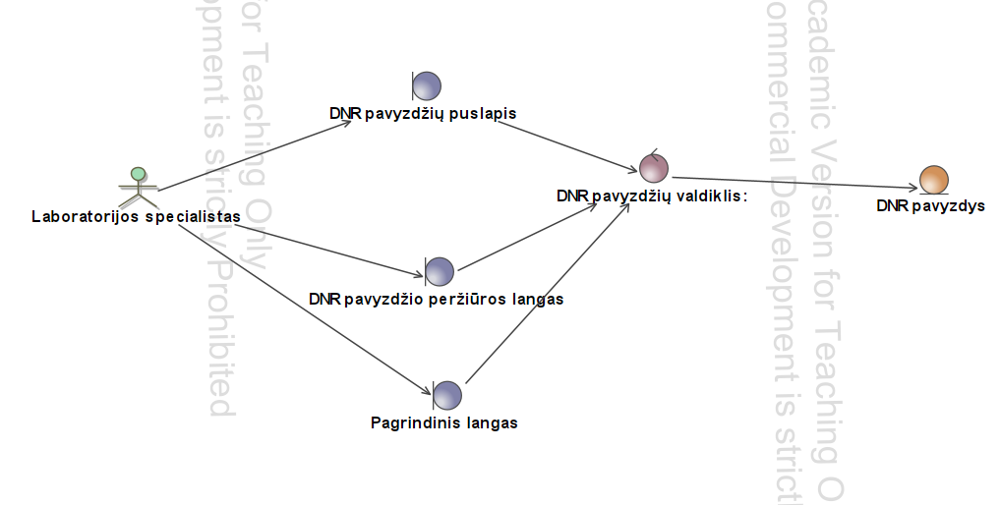

#### Ištrinti DNR pavyzdį

Trynimas inicijuojamas iš „DNR pavyzdžių puslapio“ arba „DNR pavyzdžio peržiūros lango“; valdiklis pašalina esybę „DNR pavyzdys“.

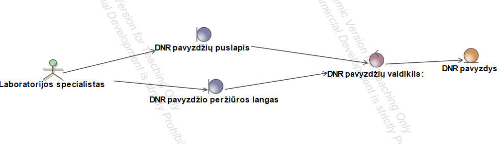

#### Automatiškai nustatyti DNR pavyzdžio tinkamumą

Valdiklis nuskaito biologinius parametrus iš esybės „DNR pavyzdys“ ir įvertina juos pagal nustatytus slenksčius; rezultatas pateikiamas „DNR pavyzdžio ataskaitos lange“.

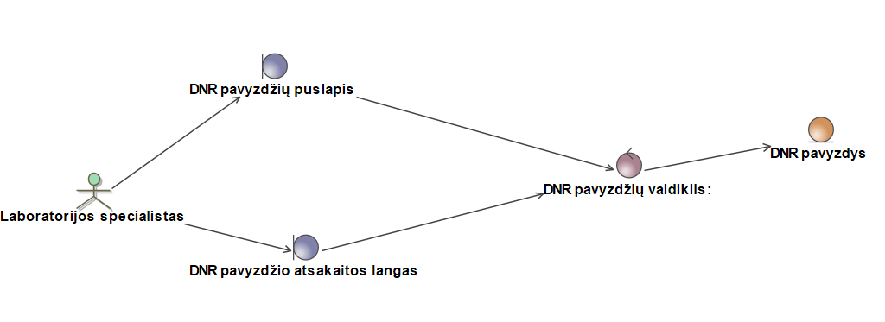

#### Redaguoti DNR pavyzdį

„DNR pavyzdžio redagavimo forma“ perduoda atnaujintus duomenis valdikliui, kuris išsaugo juos esybėje „DNR pavyzdys“.

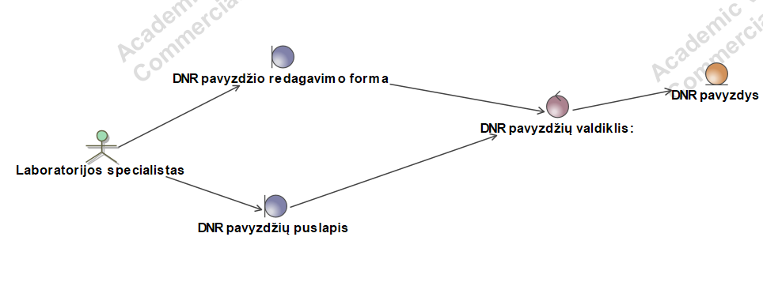

#### Sukurti DNR pavyzdį

„Naujo DNR pavyzdžio įvedimo langas“ perduoda duomenis valdikliui, kuris sukuria naują esybę „DNR pavyzdys“.

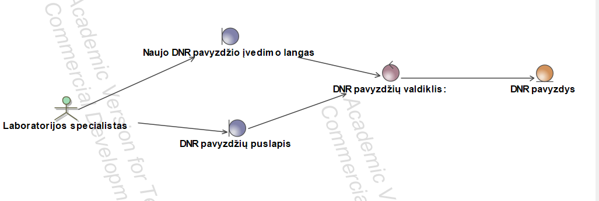

### Užsakymo valdymas

#### Peržiūrėti užsakymą

„Užsakymų sąrašo langas“, „Užsakymo peržiūros langas“ ir „Pagrindinis langas“ perduoda komandas „Užsakymų valdymo valdikliui“, kuris nuskaito esybę „Užsakymas“.

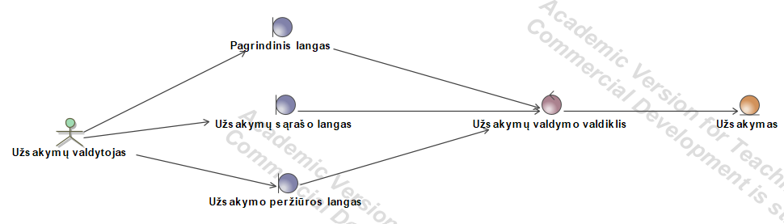

#### Automatinis kliento informavimas apie užsakymo patvirtinimą

Valdiklis, naudodamas esybes „Užsakymas“ ir „Pranešimas“, suformuoja pranešimą pagal „Laiško šabloną“ ir perduoda jį išoriniam „El. pašto serveriui“.

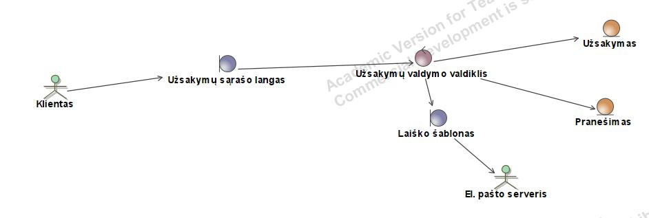

#### Ištrinti užsakymą

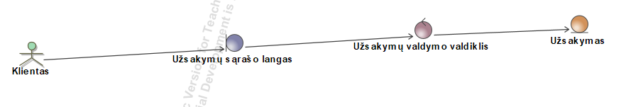

#### Redaguoti užsakymą

„Užsakymų sąrašo langas“ ir „Užsakymo redagavimo langas“ perduoda komandas valdikliui, kuris atnaujina esybę „Užsakymas“.

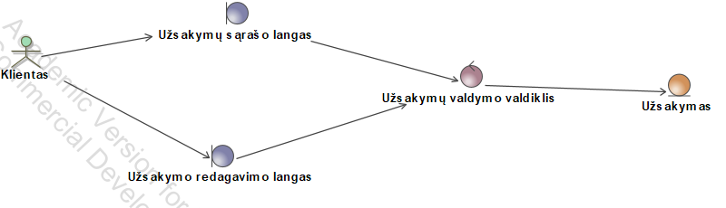

#### Sukurti užsakymą

Valdiklis nuskaito kliento ir augintinio duomenis ir sukuria naują užsakymą, naudodamas esybes „Užsakymas“, „Augintinis“ ir „Klientas“.

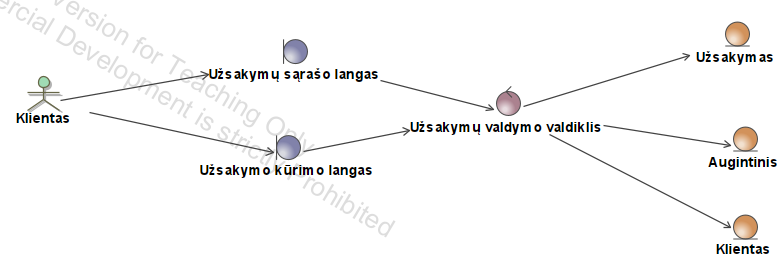

### Kliento ir augintinio valdymas

#### Prisijungti

„Prisijungimo langas“ perduoda duomenis „Prisijungimo valdikliui“, kuris juos patikrina pagal esybes „Klientas“ ir „Darbuotojas“.

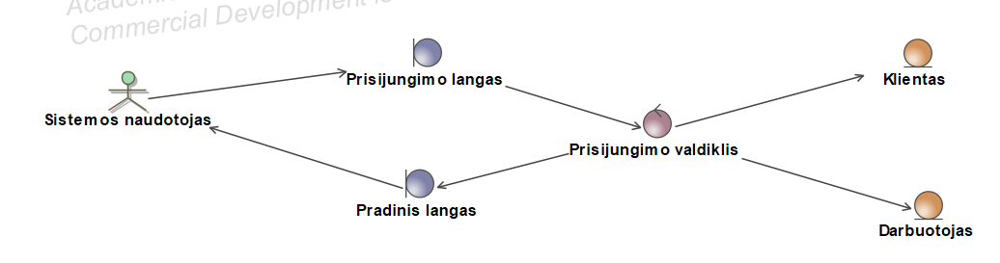

#### Registruotis

Svečias iš „Pradžios lango“ pereina į „Registracijos langą“; „Kliento valdiklis“ patikrina duomenis ir sukuria esybę „Klientas“.

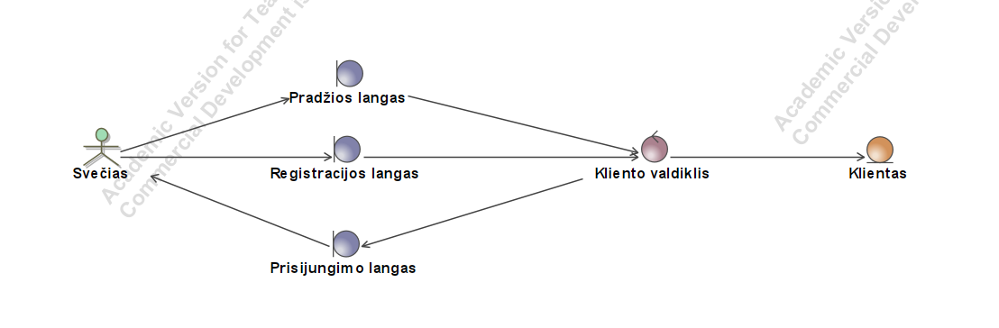

#### Atsijungti

Atsijungimas inicijuojamas per „Pagrindinį langą“ arba „Atsijungimo langą“; „Kliento valdiklis“ užbaigia sesiją.

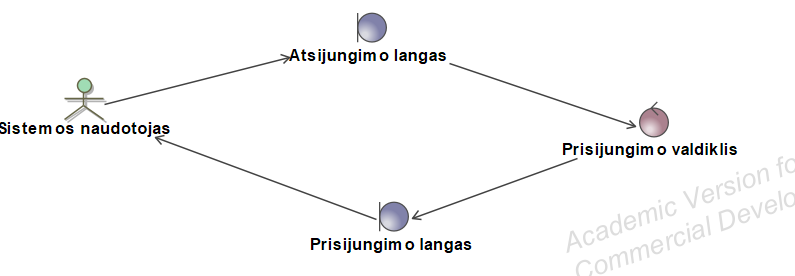

#### Sukurti gyvūną

„Augintinio kūrimo langas“ perduoda duomenis „Augintinio valdikliui“, kuris, naudodamas esybes „Klientas“ ir „Augintinis“, sukuria naują augintinį ir pateikia jį „Augintinio peržiūros lange“.

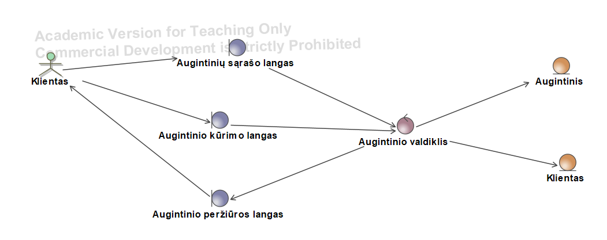

#### Redaguoti gyvūną

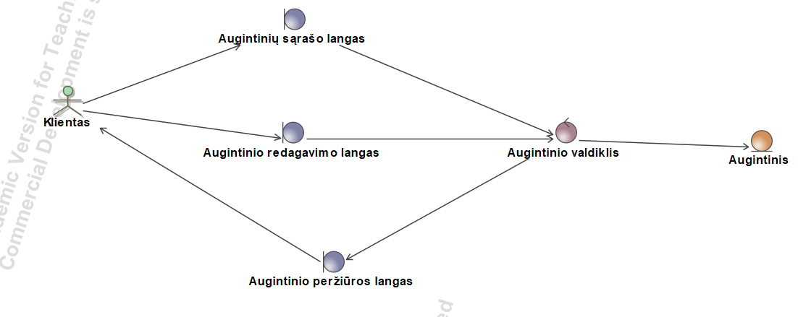

#### Peržiūrėti gyvūną

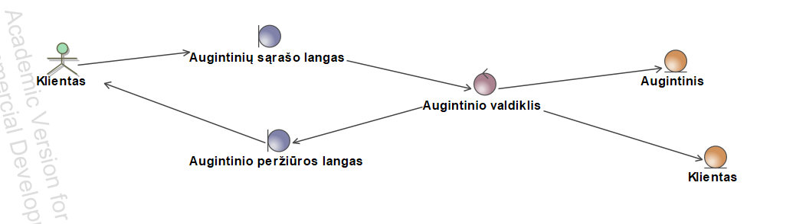

#### Ištrinti gyvūną

Patvirtinus ištrynimą „Ištrynimo patvirtinimo lange“, valdiklis pašalina esybę „Augintinis“ ir su ja susijusius dokumentus.

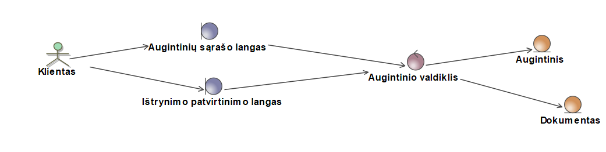

#### Peržiūrėti dokumentus

„Dokumentų valdiklis“ nuskaito augintinio dokumentus iš esybių „Augintinis“ ir „Dokumentas“.

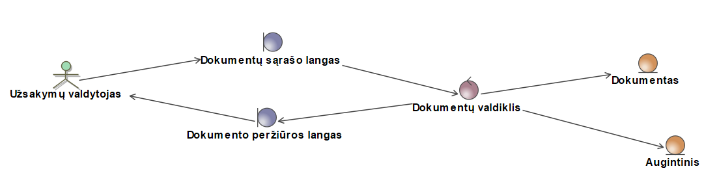

#### Įkelti dokumentą

Valdiklis patikrina failo formatą ir, susiedamas su esybe „Augintinis“, sukuria esybę „Dokumentas“.

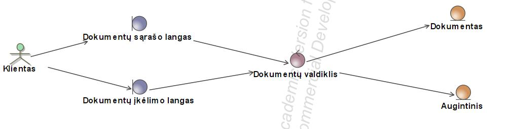

#### Redaguoti dokumentą

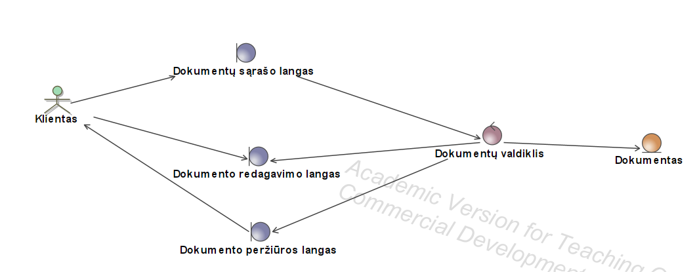

#### Ištrinti dokumentą

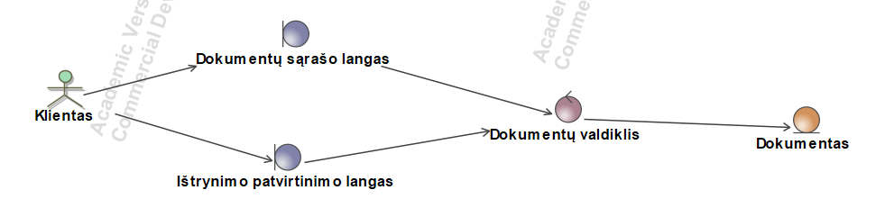

#### Patikrinti kliento istoriją

„Istorijos patikrinimo valdiklis“ per „CourtListener API sąsają“ išsiunčia užklausą išoriniam serveriui, įvertina rezultatus ir atnaujina esybę „Klientas“.

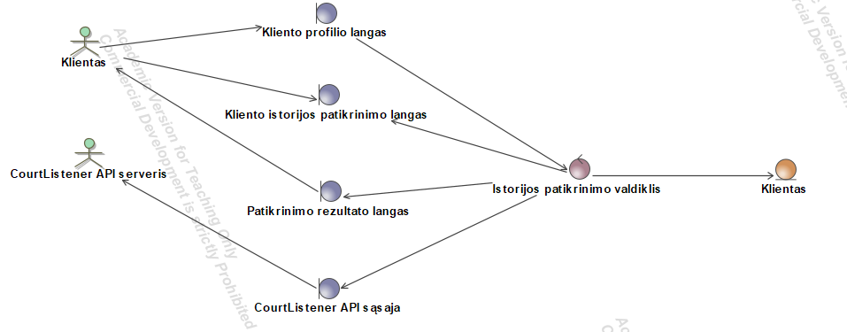

### Darbuotojų valdymas

#### Peržiūrėti darbuotoją

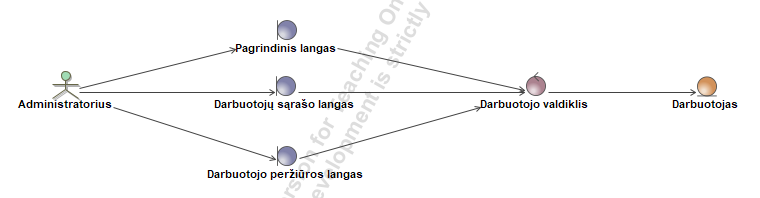

#### Sukurti darbuotoją

„Darbuotojo valdiklis“ patikrina duomenis ir sukuria esybę „Darbuotojas“; klaidingi laukai nurodomi kūrimo lange.

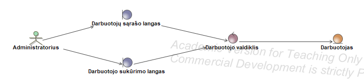

#### Redaguoti darbuotoją

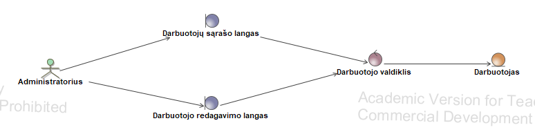

#### Ištrinti darbuotoją

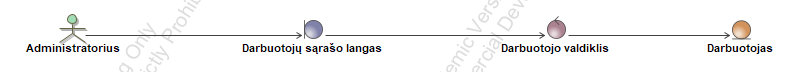

#### Peržiūrėti darbuotojo tyrimus

Valdiklis gauna tyrimų duomenis iš esybių „Darbuotojas“, „Laboratorijos specialistas“ ir „Klonavimas“.

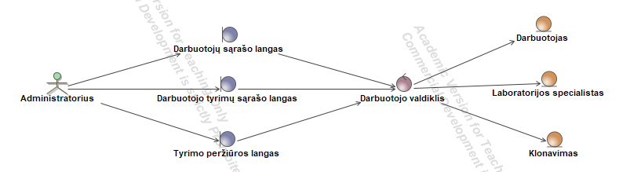

#### Analizuoti darbuotojų krūvį

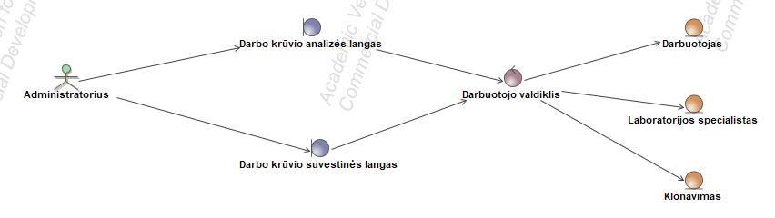

## 3.2. Naudotojo sąsajos modelis

Navigavimo planas – «boundary» klasių diagrama, rodanti perėjimus tarp langų. Langų sąrašas ir perėjimai tekstu – [`prototype/navigavimo-planas.txt`](../prototype/navigavimo-planas.txt), kiekvieno lango ekrano kopijos – [`prototype/ekrano-kopijos/`](../prototype/ekrano-kopijos/).

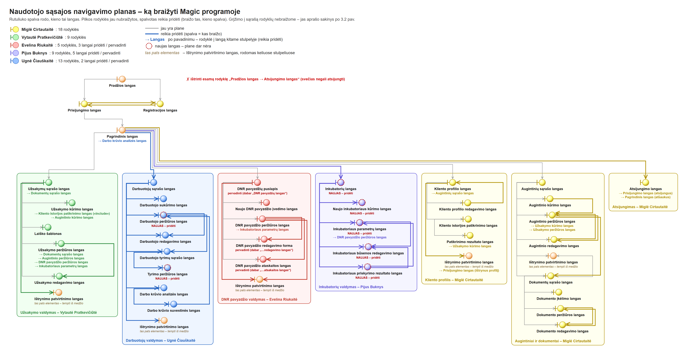

## 3.3. Duomenų srautai

#### DNR pavyzdžių valdymas

Laboratorijos specialistas keičiasi duomenimis su penkiais procesais: DNR pavyzdžio kūrimu, peržiūra, redagavimu, trynimu ir automatiniu tinkamumo nustatymu; visi jie naudoja saugyklą „DNR pavyzdys“.

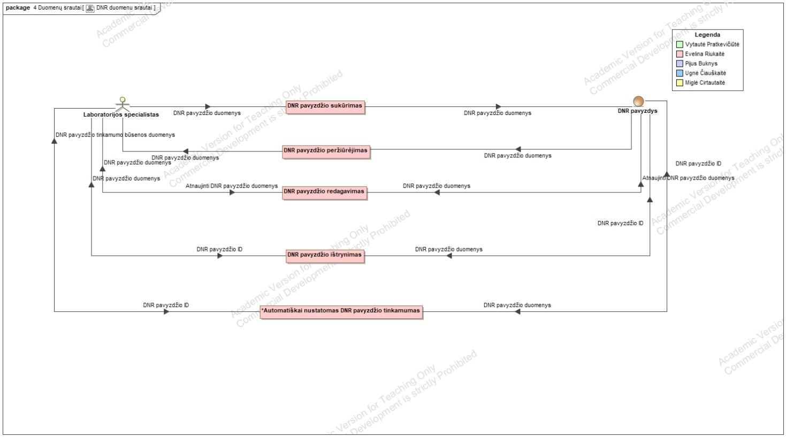

#### Užsakymų valdymas

Klientas kuria, peržiūri, redaguoja ir trina užsakymus. Užsakymo duomenys perduodami automatinio informavimo procesui, kuris įrašo pranešimą į saugyklą „Pranešimas“ ir išsiunčia laišką per išorinį el. pašto serverį.

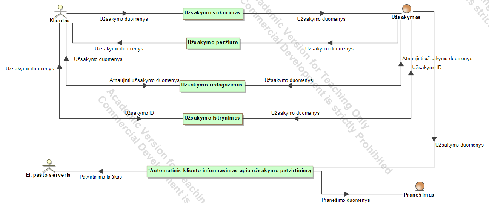

#### Darbuotojų valdymas

Administratorius keičiasi duomenimis su šešiais procesais: darbuotojo kūrimu, peržiūra, redagavimu, trynimu, tyrimų peržiūra ir krūvio analize. Tyrimams ir krūvio analizei papildomai naudojamos saugyklos „Laboratorijos specialistas“ ir „Klonavimas“.

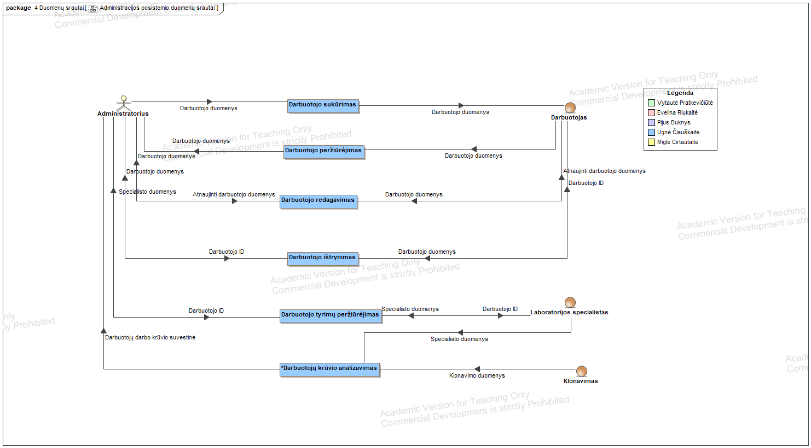

#### Kliento ir augintinio valdymas

Svečias ir sistemos naudotojas pateikia registracijos ir prisijungimo duomenis (saugykla „Klientas“). Klientas valdo augintinius ir dokumentus (saugyklos „Augintinis“, „Dokumentas“). Istorijos patikrinimo procesas kreipiasi į išorinį CourtListener API serverį ir rezultatą įrašo į saugyklą „Klientas“.

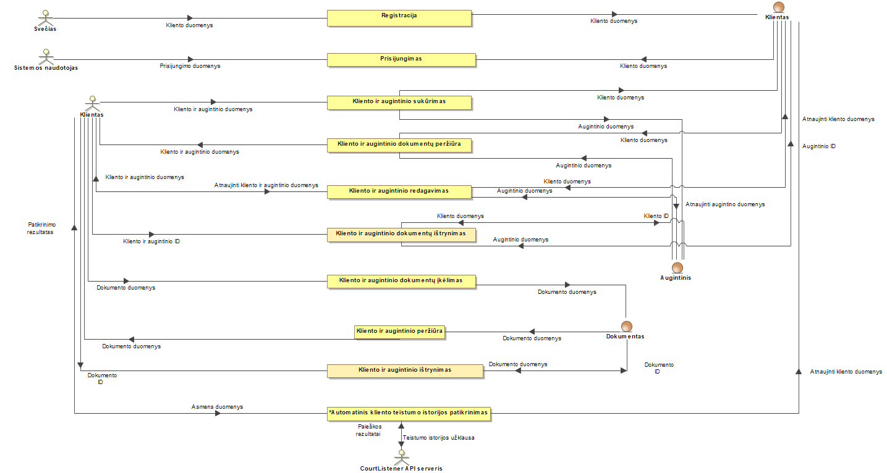
