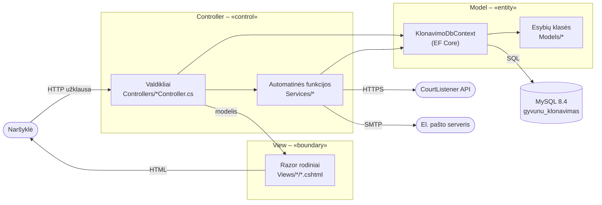
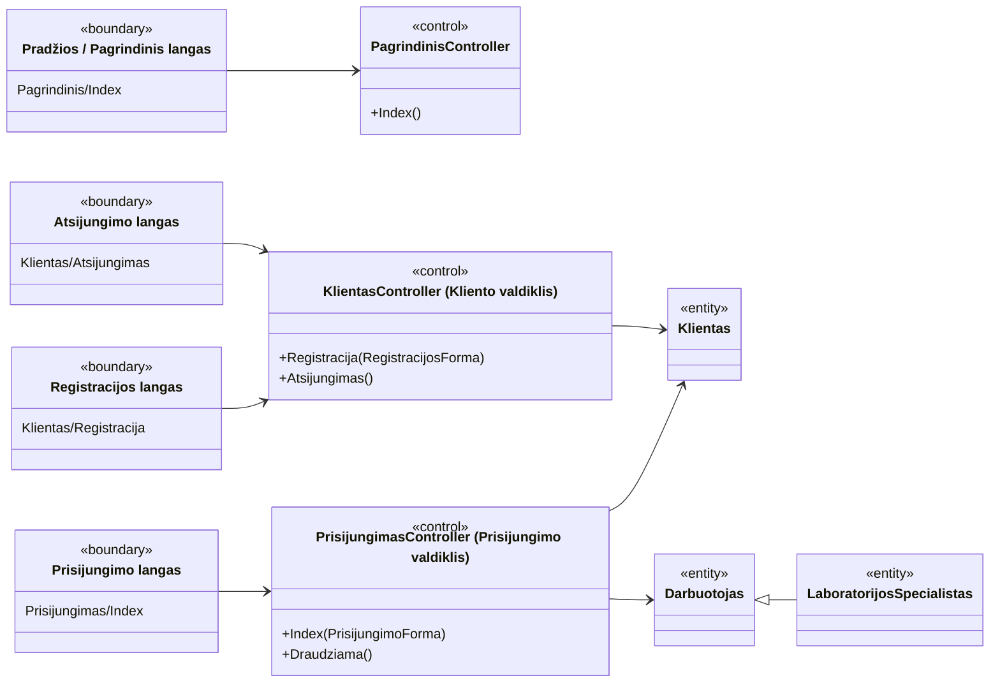
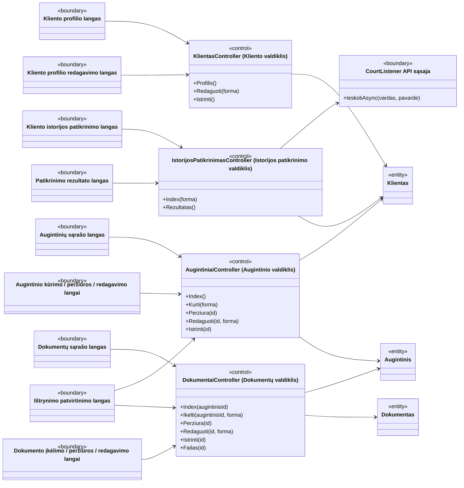
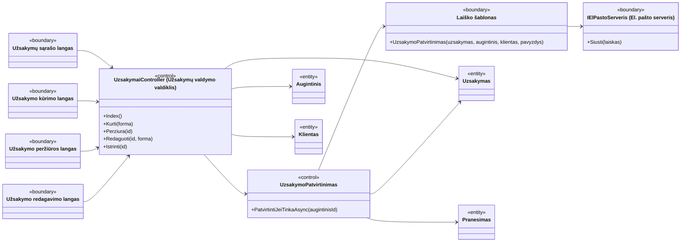
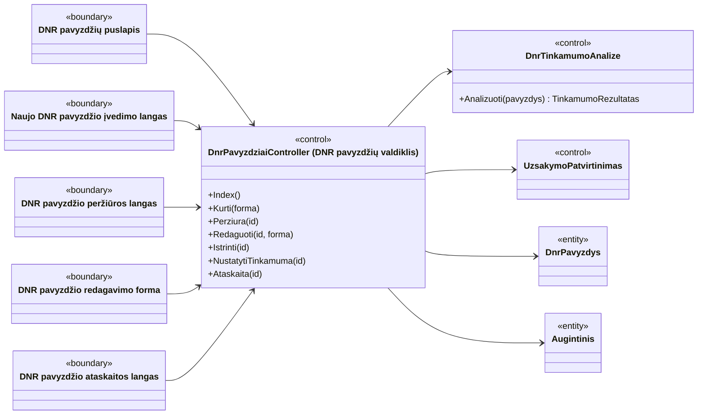
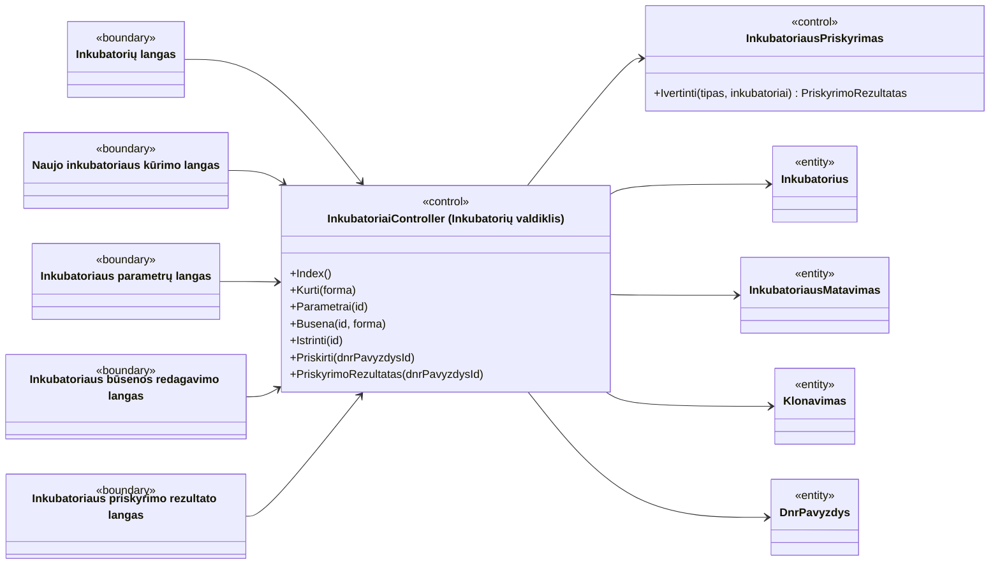
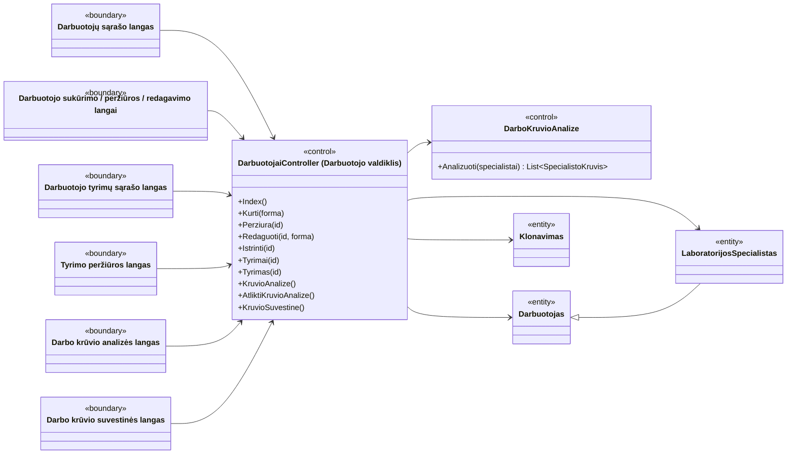

# Sistemos architektūra

Sistema realizuota ASP.NET Core MVC karkasu. Reikalavimų analizės modelio klasės ([3.1 skyrius](analize.md)) tiesiogiai tapo MVC dalimis:

| Analizės stereotipas | MVC dalis | Realizacija |
|---|---|---|
| «boundary» – naudotojo sąsajos langas | View | Razor rodinys `Views/<Valdiklis>/<Veiksmas>.cshtml`, pavadintas kaip langas navigavimo plane |
| «boundary» – išorinė sąsaja | – | `ICourtListenerSasaja` (CourtListener API), `LaiskoSablonas` + `IElPastoServeris` (el. pašto serveris) |
| «control» – valdiklis | Controller | `Controllers/<Pavadinimas>Controller.cs`, vienas veiksmas – vienas panaudojimo atvejo žingsnis |
| «control» – automatinė funkcija | Controller pagalbinė klasė | `Services/` – DNR tinkamumo analizė, inkubatoriaus priskyrimas, darbo krūvio analizė, užsakymo patvirtinimas |
| «entity» – esybė | Model | `Models/` klasės, per EF Core susietos su [duomenų bazės schemos](duomenu-baze.md) lentelėmis |

## Sluoksniai



- **Užklausos eiga**: naršyklė kreipiasi į valdiklio veiksmą (`/uzsakymai/redaguoti/5` → `UzsakymaiController.Redaguoti(5)`), valdiklis per `KlonavimoDbContext` nuskaito ar keičia esybes, prireikus kviečia automatinę funkciją ir grąžina rodinį su modeliu arba nukreipia į kitą langą su pranešimu (*Post/Redirect/Get*).
- **Prieiga pagal rolę**: slapukų autentifikacija, rolės `klientas`, `specialistas`, `administratorius`; valdikliai pažymėti `[Authorize(Roles = …)]`. Slaptažodžiai saugomi kaip PBKDF2 maišos.
- **Duomenų bazė kuriama iš schemos**: paleidžiant programą, jei duomenų bazės nėra, vykdomas tas pats [`database/schema.sql`](../database/schema.sql), kuris pateiktas dokumentacijoje, todėl naudojama DB visada atitinka suprojektuotą schemą. EF Core naudojamas tik duomenims skaityti ir rašyti.
- **Automatinės funkcijos** parašytos kaip grynos funkcijos (be DB), todėl jas tikrina vienetų testai (`tests/`).
- **Išorinės sąsajos** paslėptos už sąsajų: be CourtListener rakto naudojama demonstracinė paieška, be SMTP serverio laiškai įrašomi kaip `.eml` failai.

## Klasės pagal posistemes

Kiekvienoje diagramoje: kairėje – langai («boundary»), viduryje – valdiklis ir jo veiksmai («control»), dešinėje – esybės («entity»). Rodyklės rodo, kurie langai kreipiasi į valdiklį ir kurias esybes valdiklis naudoja, kaip analizės diagramose.

### Bendri langai, prisijungimas ir registracija



### Kliento ir augintinio valdymas



### Užsakymo valdymas



### DNR pavyzdžio valdymas



### Inkubatorių valdymas



### Darbuotojų valdymas



## Esybės («entity»)

Modelio klasės sutampa su [esybių klasių diagrama](reikalavimai.md#23-dalykinės-srities-esybių-klasės): `Klientas`, `Augintinis`, `GyvunoTipas`, `Dokumentas`, `Uzsakymas`, `Pranesimas`, `DnrPavyzdys`, `Klonavimas`, `Inkubatorius`, `InkubatoriausMatavimas`, `Darbuotojas`, `LaboratorijosSpecialistas`. `KlonavimoDbContext` jas susieja su lentelėmis: savybė `DnrPavyzdysId` → stulpelis `dnr_pavyzdys_id`, `GyvunoTipas` → `ENUM`, paveldėjimas → atskira lentelė `laboratorijos_specialistas` (*table per type*).

## Projekto struktūra

```text
database/schema.sql               duomenų bazės schema (MySQL 8.4)
src/GyvunuKlonavimoSistema/
├── Controllers/                  «control»: valdikliai
├── Services/                     «control»: automatinės funkcijos; «boundary»: išorinės sąsajos
├── Models/                       «entity»: esybių klasės
├── Data/                         EF Core kontekstas, DB kūrimas iš schemos, demonstraciniai duomenys
├── ViewModels/                   formų ir langų modeliai su tikrinimo taisyklėmis
├── Views/                        «boundary»: langai (Razor rodiniai)
├── Infrastructure/               rolės, meniu, formatavimas, būsenų žymos
└── wwwroot/                      stilius ir naršyklės skriptas
tests/GyvunuKlonavimoSistema.Tests/   automatinių funkcijų vienetų testai
prototype/                        GUI prototipas (3 lab. darbas)
docs/                             UML modeliai ir šis aprašas
```

## Technologijos

| Sritis | Technologija |
|---|---|
| Kalba ir karkasas | C# 14, .NET 10, ASP.NET Core MVC (Razor) |
| Duomenų bazė | MySQL 8.4, EF Core 10 su `MySql.EntityFrameworkCore` tiekėju |
| Testai | xUnit |
| CI | GitHub Actions: kompiliavimas, testai ir paleidimas su MySQL konteineriu |
| Modeliavimas | Magic Systems of Systems Architect |
