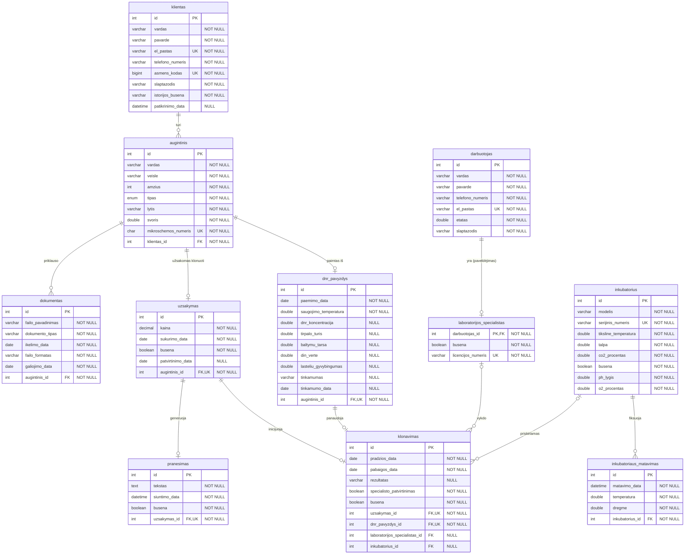

# Duomenų bazės schema

Duomenų bazės schema gauta transformuojant dalykinės srities esybių klasių diagramą ([2.3 pav.](reikalavimai.md#23-dalykinės-srities-esybių-klasės)). SQL scenarijus – [`database/schema.sql`](../database/schema.sql), DBVS – MySQL 8.4, koduotė `utf8mb4`, rikiavimas pagal lietuvių kalbos taisykles (`utf8mb4_lt_0900_ai_ci`).

Transformavimo taisyklės:

- kiekviena «Entity» klasė tampa lentele «table» tuo pačiu pavadinimu (mažosiomis raidėmis, žodžiai skiriami `_`);
- kiekviena lentelė gauna pirminį raktą «PK» `id` (`INT AUTO_INCREMENT`);
- asociacija 1 : 0..\* ar 1 : 0..1 tampa išoriniu raktu «FK» `<lentelė>_id` „daugelio“ pusėje; ryšiui 1 : 0..1 papildomai nustatomas `UNIQUE` apribojimas;
- paveldėjimas *Darbuotojas ← Laboratorijos specialistas* realizuotas atskira lentele su bendru pirminiu raktu (*table per type*): `laboratorijos_specialistas.darbuotojas_id` yra ir «PK», ir «FK». Darbuotojas, neturintis įrašo šioje lentelėje, yra administratorius;
- išvardijimo tipas *GyvunoTipas* realizuotas MySQL `ENUM` tipu;
- UML tipai atvaizduojami taip: `String` → `VARCHAR`/`CHAR`/`TEXT`, `int` → `INT`/`BIGINT`, `float` → `DOUBLE` (kaina – `DECIMAL(10,2)`), `boolean` → `BOOLEAN`, `date` → `DATE` arba `DATETIME`, kai svarbus ir laikas.

## Schema

### Spalvinė legenda

Lentelės priskirtos komandos nariams taip pat, kaip esybės esybių klasių diagramoje:

| Spalva | Komandos narys | Lentelės |
|---|---|---|
| 🟩 žalia | Vytautė Pratkevičiūtė | `uzsakymas`, `pranesimas` |
| 🟥 rausva | Evelina Riukaitė | `dnr_pavyzdys`, `klonavimas` |
| 🟪 violetinė | Pijus Buknys | `inkubatorius`, `inkubatoriaus_matavimas` |
| 🟦 mėlyna | Ugnė Čiauškaitė | `darbuotojas`, `laboratorijos_specialistas` |
| 🟨 geltona | Miglė Cirtautaitė | `klientas`, `augintinis`, `dokumentas` |

Žymėjimai: **PK** – pirminis raktas, **FK** – išorinis raktas, **UK** – unikalus laukas; `NOT NULL` – privalomas laukas, `NULL` – neprivalomas.

## Lentelių aprašymas

### `klientas`

Sistemos naudotojai – klientai, užsakantys augintinių klonavimą.

| Laukas | Tipas | Raktas | Privalomas | Aprašymas |
|---|---|---|---|---|
| `id` | `INT` | PK | taip | Kliento identifikatorius |
| `vardas` | `VARCHAR(50)` | | taip | Vardas |
| `pavarde` | `VARCHAR(50)` | | taip | Pavardė |
| `el_pastas` | `VARCHAR(100)` | UK | taip | El. paštas, naudojamas prisijungti |
| `telefono_numeris` | `VARCHAR(20)` | | taip | Telefono numeris |
| `asmens_kodas` | `BIGINT` | UK | taip | 11 skaitmenų asmens kodas |
| `slaptazodis` | `VARCHAR(255)` | | taip | Slaptažodžio maiša (PBKDF2), ne pats slaptažodis |
| `istorijos_busena` | `VARCHAR(20)` | | taip | `Nepatikrintas`, `Patikrintas` arba `Netinkamas` (rasta teistumo įrašų) |
| `patikrinimo_data` | `DATETIME` | | ne | Paskutinio CourtListener patikrinimo laikas |

### `augintinis`

Klientų augintiniai, kuriuos norima klonuoti.

| Laukas | Tipas | Raktas | Privalomas | Aprašymas |
|---|---|---|---|---|
| `id` | `INT` | PK | taip | Augintinio identifikatorius |
| `vardas` | `VARCHAR(50)` | | taip | Augintinio vardas |
| `veisle` | `VARCHAR(80)` | | taip | Veislė |
| `amzius` | `INT` | | taip | Amžius metais (0–100) |
| `tipas` | `ENUM` | | taip | *GyvunoTipas*: `Šuo`, `Katė`, `Triušis`, `Žirgas`, `Avis`, `Kiaulė`, `Papūga` |
| `lytis` | `VARCHAR(10)` | | taip | `Patinas` arba `Patelė` |
| `svoris` | `DOUBLE` | | taip | Svoris kilogramais (> 0) |
| `mikroschemos_numeris` | `CHAR(15)` | UK | taip | 15 skaitmenų mikroschemos numeris (ISO 11784) |
| `klientas_id` | `INT` | FK → `klientas` | taip | Savininkas; ištrynus klientą ištrinami ir jo augintiniai |

### `dokumentas`

Augintinio dokumentai (kilmės sertifikatai, sutartys, veterinariniai pasai). Pats failas saugomas failų saugykloje, pavadintas įrašo `id`.

| Laukas | Tipas | Raktas | Privalomas | Aprašymas |
|---|---|---|---|---|
| `id` | `INT` | PK | taip | Dokumento identifikatorius |
| `failo_pavadinimas` | `VARCHAR(255)` | | taip | Dokumento (failo) pavadinimas |
| `dokumento_tipas` | `VARCHAR(50)` | | taip | `Kilmės sertifikatas`, `Sutartis`, `Veterinarinis pasas` arba `Kita` |
| `ikelimo_data` | `DATE` | | taip | Įkėlimo data |
| `failo_formatas` | `VARCHAR(10)` | | taip | `PDF`, `JPG` arba `PNG` |
| `galiojimo_data` | `DATE` | | taip | Galiojimo pabaigos data |
| `augintinis_id` | `INT` | FK → `augintinis` | taip | Augintinis, kuriam priklauso dokumentas |

### `uzsakymas`

Klonavimo užsakymai. Augintinis gali turėti ne daugiau kaip vieną užsakymą.

| Laukas | Tipas | Raktas | Privalomas | Aprašymas |
|---|---|---|---|---|
| `id` | `INT` | PK | taip | Užsakymo identifikatorius (rodomas kaip `UZ-0001`) |
| `kaina` | `DECIMAL(10,2)` | | taip | Kaina eurais, nustatoma pagal gyvūno tipą |
| `sukurimo_data` | `DATE` | | taip | Sukūrimo data |
| `busena` | `BOOLEAN` | | taip | `FALSE` – nepatvirtintas, `TRUE` – patvirtintas |
| `patvirtinimo_data` | `DATE` | | ne | Patvirtinimo data; privaloma, kai užsakymas patvirtintas |
| `augintinis_id` | `INT` | FK → `augintinis`, UK | taip | Klonuojamas augintinis |

### `pranesimas`

Klientui išsiųsti pranešimai apie užsakymo patvirtinimą.

| Laukas | Tipas | Raktas | Privalomas | Aprašymas |
|---|---|---|---|---|
| `id` | `INT` | PK | taip | Pranešimo identifikatorius |
| `tekstas` | `TEXT` | | taip | Pagal laiško šabloną suformuotas tekstas |
| `siuntimo_data` | `DATETIME` | | taip | Siuntimo laikas |
| `busena` | `BOOLEAN` | | taip | `TRUE` – išsiųstas, `FALSE` – neišsiųstas |
| `uzsakymas_id` | `INT` | FK → `uzsakymas`, UK | taip | Užsakymas, apie kurio patvirtinimą pranešama |

### `dnr_pavyzdys`

Iš augintinio paimti DNR pavyzdžiai ir jų analizės rezultatai.

| Laukas | Tipas | Raktas | Privalomas | Aprašymas |
|---|---|---|---|---|
| `id` | `INT` | PK | taip | Pavyzdžio identifikatorius (rodomas kaip `DNR-0001`) |
| `paemimo_data` | `DATE` | | taip | Paėmimo data |
| `saugojimo_temperatura` | `DOUBLE` | | taip | Saugojimo temperatūra, °C (norma ≤ −20) |
| `dnr_koncentracija` | `DOUBLE` | | ne | ng/µl (norma ≥ 50) |
| `tirpalo_turis` | `DOUBLE` | | ne | ml (norma ≥ 0,02) |
| `baltymu_tarsa` | `DOUBLE` | | ne | A260/280 santykis (norma 1,8–2,0) |
| `din_verte` | `DOUBLE` | | ne | DNR vientisumo skaičius (norma ≥ 7) |
| `lasteliu_gyvybingumas` | `DOUBLE` | | ne | % (norma ≥ 80) |
| `tinkamumas` | `VARCHAR(20)` | | ne | `Tinkamas klonuoti` arba `Netinkamas`; tuščias, kol tinkamumas nenustatytas |
| `tinkamumo_data` | `DATE` | | ne | Tinkamumo nustatymo data |
| `augintinis_id` | `INT` | FK → `augintinis`, UK | taip | Augintinis, iš kurio paimtas pavyzdys |

Analizės rezultatai neprivalomi, nes įvedami vėliau nei sukuriamas pavyzdys.

### `klonavimas`

Klonavimo procesai, pradedami priskyrus inkubatorių tinkamam DNR pavyzdžiui.

| Laukas | Tipas | Raktas | Privalomas | Aprašymas |
|---|---|---|---|---|
| `id` | `INT` | PK | taip | Klonavimo identifikatorius (rodomas kaip `KL-0001`) |
| `pradzios_data` | `DATE` | | taip | Pradžios data |
| `pabaigos_data` | `DATE` | | taip | Numatoma pabaigos data (pagal gyvūno vaikingumo trukmę) |
| `rezultatas` | `VARCHAR(255)` | | ne | Rezultato aprašymas |
| `specialisto_patvirtinimas` | `BOOLEAN` | | taip | Ar specialistas patvirtino rezultatą |
| `busena` | `BOOLEAN` | | taip | `TRUE` – aktyvus, `FALSE` – baigtas |
| `uzsakymas_id` | `INT` | FK → `uzsakymas`, UK | taip | Vykdomas užsakymas; kol yra klonavimas, užsakymo ištrinti negalima |
| `dnr_pavyzdys_id` | `INT` | FK → `dnr_pavyzdys`, UK | taip | Naudojamas DNR pavyzdys; kol yra klonavimas, pavyzdžio ištrinti negalima |
| `laboratorijos_specialistas_id` | `INT` | FK → `laboratorijos_specialistas` | ne | Vykdantis specialistas; ištrynus darbuotoją – `NULL` |
| `inkubatorius_id` | `INT` | FK → `inkubatorius` | ne | Priskirtas inkubatorius; ištrynus inkubatorių – `NULL` |

### `inkubatorius`

Laboratorijos inkubatoriai ir jų techniniai parametrai.

| Laukas | Tipas | Raktas | Privalomas | Aprašymas |
|---|---|---|---|---|
| `id` | `INT` | PK | taip | Inkubatoriaus identifikatorius |
| `modelis` | `VARCHAR(100)` | | taip | Gamintojas ir modelis |
| `serijinis_numeris` | `VARCHAR(50)` | UK | taip | Serijinis numeris |
| `tiksline_temperatura` | `DOUBLE` | | taip | °C (20–45) |
| `talpa` | `DOUBLE` | | taip | Talpa litrais |
| `co2_procentas` | `DOUBLE` | | taip | CO₂ koncentracija, % (0–20) |
| `busena` | `BOOLEAN` | | taip | `FALSE` – laisvas, `TRUE` – užimtas |
| `ph_lygis` | `DOUBLE` | | taip | pH (6–8,5) |
| `o2_procentas` | `DOUBLE` | | taip | O₂ koncentracija, % (1–21) |

### `inkubatoriaus_matavimas`

Periodiškai fiksuojami inkubatoriaus temperatūros ir drėgmės matavimai.

| Laukas | Tipas | Raktas | Privalomas | Aprašymas |
|---|---|---|---|---|
| `id` | `INT` | PK | taip | Matavimo identifikatorius |
| `matavimo_data` | `DATETIME` | | taip | Matavimo laikas |
| `temperatura` | `DOUBLE` | | taip | Išmatuota temperatūra, °C |
| `dregme` | `DOUBLE` | | taip | Santykinė drėgmė, % |
| `inkubatorius_id` | `INT` | FK → `inkubatorius` | taip | Inkubatorius; ištrynus jį ištrinami ir matavimai |

### `darbuotojas`

Laboratorijos darbuotojai (specialistai ir administratoriai).

| Laukas | Tipas | Raktas | Privalomas | Aprašymas |
|---|---|---|---|---|
| `id` | `INT` | PK | taip | Darbuotojo identifikatorius |
| `vardas` | `VARCHAR(50)` | | taip | Vardas |
| `pavarde` | `VARCHAR(50)` | | taip | Pavardė |
| `telefono_numeris` | `VARCHAR(20)` | | taip | Telefono numeris |
| `el_pastas` | `VARCHAR(100)` | UK | taip | El. paštas, naudojamas prisijungti |
| `etatas` | `DOUBLE` | | taip | Etato dalis (0,25–1) |
| `slaptazodis` | `VARCHAR(255)` | | taip | Slaptažodžio maiša (PBKDF2) |

### `laboratorijos_specialistas`

Darbuotojai, atliekantys DNR analizę ir klonavimą.

| Laukas | Tipas | Raktas | Privalomas | Aprašymas |
|---|---|---|---|---|
| `darbuotojas_id` | `INT` | PK, FK → `darbuotojas` | taip | Darbuotojo identifikatorius |
| `busena` | `BOOLEAN` | | taip | `TRUE` – aktyvus, `FALSE` – neaktyvus |
| `licencijos_numeris` | `VARCHAR(20)` | UK | taip | Licencijos numeris |

## Vientisumo apribojimai

- **Kaskadinis trynimas** (`ON DELETE CASCADE`) taikomas priklausomiems duomenims: klientas → augintiniai → dokumentai, užsakymas, DNR pavyzdys; užsakymas → pranešimas; inkubatorius → matavimai; darbuotojas → specialisto įrašas.
- **Draudžiamas trynimas** (`ON DELETE RESTRICT`): užsakymo ir DNR pavyzdžio, kurie naudojami klonavime, ištrinti negalima, todėl negalima ištrinti ir augintinio ar kliento su vykdomu klonavimu.
- **`SET NULL`**: ištrynus specialistą ar inkubatorių, klonavimo istorija išlieka, tik be nuorodos į juos.
- **`CHECK`** apribojimai tikrina reikšmių sritis: būsenų ir tipų sąrašus, amžiaus, svorio, etato ir inkubatoriaus parametrų ribas, datų tvarką, o patvirtintam užsakymui reikalauja patvirtinimo datos.

## Skirtumai nuo esybių klasių diagramos

Realizuojant sistemą lentelės papildytos laukais, kurių reikia veikimui, bet nėra esybių klasių diagramoje. Esybių diagramą verta atnaujinti, kad abu modeliai sutaptų:

| Lentelė | Laukas | Priežastis |
|---|---|---|
| `darbuotojas` | `slaptazodis` | Darbuotojai prisijungia prie sistemos kaip ir klientai (3.1.7 pav.) |
| `dnr_pavyzdys` | `tinkamumas`, `tinkamumo_data` | Saugomas automatinio tinkamumo nustatymo rezultatas (2.20 pav.), pagal jį atrenkami pavyzdžiai inkubatoriaus priskyrimui |
| `laboratorijos_specialistas` | `licencijos_numeris` | Diagramoje atributas parašytas su klaida (`licenzijos_numeris`) |
